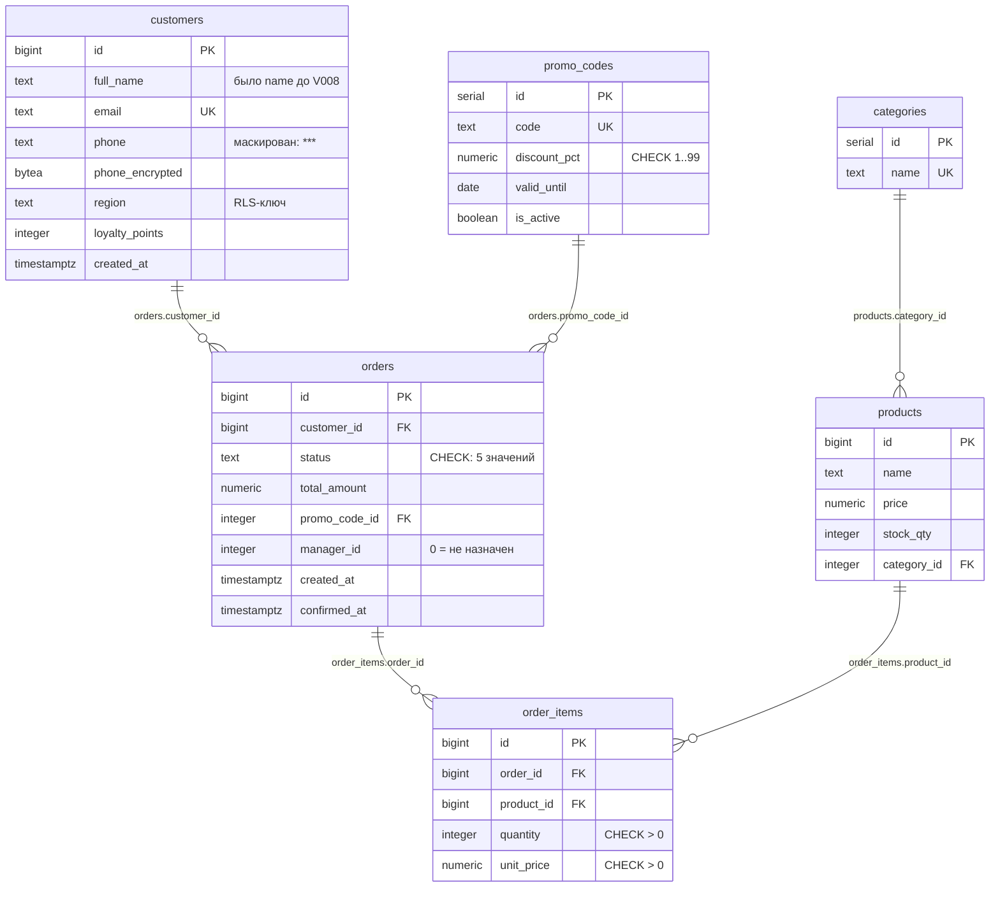

# Итоговый отчёт: проект eshop

**Студент:** Исобаева Дарья Александровна
**Группа:** ПИ 4-1
**Дата:** 2026-11-05
**СУБД:** PostgreSQL 18.6 (Windows x86_64) · Flyway 10.22.0 · PgBouncer 1.26.1

---

## 1. Описание базы данных

**Назначение.** `eshop` — учебная база интернет-магазина: клиенты, товары с категориями,
заказы с позициями, промокоды, история цен и журнал аудита. Используется для отработки
резервного копирования, мониторинга, оптимизации запросов, ИБ и управления миграциями.

**Объём (после лабораторных 06–10):**

| Таблица | Строк | Размер (с индексами) |
|---|---|---|
| order_items | 600 000 | 65 МБ |
| orders | 200 000 | 40 МБ |
| customers | 20 000 | 6,1 МБ |
| products | 1 000 | 184 кБ |
| categories | 3 | 48 кБ |
| promo_codes | 2 | 48 кБ |
| audit_log, price_history | 0 | по 8 кБ |
| **вся база** | | **119 МБ** |

**ERD:**



Отдельно: `audit_log`, `price_history` (без FK на `products` — замечание на будущее),
`orders_summary` (представление из R__-миграции), `flyway_schema_history` (служебная таблица Flyway).

> **Исправление по ходу курса.** После лаб. 02 у `order_items` не было ни первичного ключа,
> ни identity-генератора, ни внешних ключей — скрипт наполнения лаб. 06 в такой схеме не работал.
> Добавлены `order_items_pkey`, identity на `id`, FK на `orders(id)` и `products(id)`.

## 2. Ролевая модель

| Роль | Тип | Назначение | Права |
|---|---|---|---|
| `postgres` | суперпользователь, LOGIN | администратор БД (DBA) | всё |
| `eshop_app` | NOLOGIN, групповая | права приложения | `SELECT` на `customers`, `products`; `SELECT/INSERT/UPDATE` на `orders`, `order_items` |
| `app_backend` | LOGIN, член `eshop_app` | учётная запись приложения | наследует права `eshop_app` |
| `eshop_readonly` | NOLOGIN, групповая | аналитики (только чтение) | `SELECT` на все бизнес-таблицы |
| `analyst_ivanova` | LOGIN, член `eshop_readonly` | аналитик региона | `SELECT` + RLS по региону |
| `eshop_report` | NOLOGIN, групповая | отчётность | `SELECT` на все бизнес-таблицы |
| `analyst_petrov` | LOGIN, член `eshop_report` | отчётность | `SELECT` без RLS |
| `repl_user` | LOGIN, REPLICATION | физическая репликация | репликация |

**RLS.** Включена политика `customers_by_region` на `customers`:

```sql
POLICY "customers_by_region" FOR SELECT TO eshop_readonly
  USING (region = current_setting('app.current_region', true))
```

Проверено: `analyst_ivanova` с `SET app.current_region = 'MSK'` видит **1 007** строк из 20 000;
без установки параметра — **0** строк (выражение даёт `NULL`).

## 3. Резервное копирование

Регламент (`backup/backup_policy.md`):

| Уровень | Команда | Частота | Хранить |
|---|---|---|---|
| Физический | `pg_basebackup` | ежедневно | 7 дней |
| Логический | `pg_dump -Fc` | ежедневно | 14 дней |
| WAL-архив | `archive_command` | непрерывно | 7 дней |
| Глобальные роли | `pg_dumpall --globals` | еженедельно | 4 недели |

Правило 3-2-1: 3 копии, 2 носителя, 1 копия вне офиса.

**Целевые RPO / RTO для eshop:**

| Показатель | Значение | Чем обеспечивается |
|---|---|---|
| **RPO** | ≤ 15 минут | непрерывная архивация WAL: потеря ограничена последним заархивированным сегментом (по умолчанию `archive_timeout`, при необходимости — 300 с) |
| **RTO** | ≤ 1 часа | восстановление `pg_basebackup` (119 МБ) + WAL до нужной точки (PITR); проверено на учебной катастрофе в лаб. 04 |

## 4. Мониторинг

Метрики и пороги для алертов:

| Метрика | Источник | Норма | Алерт |
|---|---|---|---|
| Cache hit ratio | `pg_stat_database` | > 99 % | < 99 % 15 мин |
| `dead_pct` по таблице | `pg_stat_user_tables` | < 10 % | > 20 % |
| `idle in transaction` | `pg_stat_activity` | 0 | сессия > 5 мин |
| Долгие запросы | лог, `log_min_duration_statement = 500ms` | — | > 5 с |
| Ожидание блокировок | `log_lock_waits`, `pg_blocking_pids()` | 0 | > 30 с |
| Число соединений | `pg_stat_activity` | < 80 % от `max_connections` (100) | > 80 |
| Ошибки autovacuum | `pg_stat_user_tables.last_autovacuum` | ежедневно | нет 3 дня |
| WAL-архив | `pg_stat_archiver` | `failed_count = 0` | > 0 |

Измерено в лаб. 05 на «боевом» состоянии: cache hit **98,33 %** (малый объём, холодный старт),
`dead_pct(orders)` **82,4 %** при 14 мёртвых строках из 17 — то есть `dead_pct` без абсолютных чисел
вводит в заблуждение, в алертах нужны оба показателя.

## 5. Производительность

### Индексы и зачем они созданы

| Индекс | Обоснование | Эффект (измерено) |
|---|---|---|
| `idx_customers_region` | фильтр `region = 'MSK'` (5 % строк) | Seq Scan 20 000 → Bitmap 1 007 строк |
| `idx_orders_created_at` | фильтр `created_at > now() - 30 days` (4 %) | 8 124 строки вместо 200 000 |
| `idx_orders_customer_id` | соединение `orders` ⨝ `customers`, FK-проверки | Merge/Index Scan вместо хеша 200 000 строк |
| `idx_order_items_order` | главное соединение `orders` ⨝ `order_items` | план 128 → 19 мс (×6,7); FK-триггер 25,6 → 0,7 мс (×36) |
| `idx_order_items_product` | продажи по товару + FK на `products` (`CONCURRENTLY`) | 158 → 2,3 мс, страниц 5 000 → 572 |
| `idx_orders_active` (частичный) | активные заказы (5 % строк) | 88 кБ против 1 400 кБ полного индекса (×16), 5,4 мс |
| `idx_orders_status_created` (составной) | `status = … AND created_at > …` | BitmapAnd 1,89 мс / 188 буферов → Index Scan 0,76 мс / 147 буферов |
| `idx_customers_email_lower` (по выражению) | поиск по email без учёта регистра | 5,32 → 0,09 мс |
| `idx_products_name_lower` (по выражению) | поиск товара по названию без регистра | используется, 0,06 мс |
| `idx_orders_total_amount` | топ заказов по сумме (`CONCURRENTLY`, лаб. 10) | создан без блокировки записи |

Неиспользуемых индексов **без** ограничений не осталось; `idx_order_items_order` имел `idx_scan = 0`
после перезапуска, но нужен для FK-проверок — не удалялся.

### Autovacuum

Для `orders` изменены настройки таблицы (лаб. 07):

```sql
ALTER TABLE orders SET (autovacuum_vacuum_scale_factor = 0.01,
                        autovacuum_analyze_scale_factor = 0.005);
```

Порог снизился с **40 050** до **2 050** мёртвых строк. Проверено: после 1 000 обновлений
autovacuum не запускался, после 5 000 — запустился (`autovacuum_count` 1 → 2,
`n_dead_tup` 5 000 → 0). Работа autovacuum наблюдалась в `pg_stat_progress_vacuum`
(`scanning heap 3350/3640` → `vacuuming heap 3640/3640`).

### PgBouncer

**Используется.** `pool_mode = transaction`, `default_pool_size = 10`, `reserve_pool_size = 5`.
Измерено при 50 клиентах: **10** backend-процессов вместо **60**, память на соединения
≈ 55 МБ вместо ≈ 264 МБ. Плата — tps 3 232 против 4 348 и задержка 15,5 против 11,5 мс
(дополнительный сетевой переход). Обоснование: [`pgbouncer_justification.md`](pgbouncer_justification.md).

### Прочее

- `work_mem` по умолчанию 4 МБ: `HashAggregate` в Q1 уходил в `Batches: 5` с записью на диск;
  запрос переписан (агрегация до JOIN) — 171 → 99 мс.
- `VACUUM FULL` + `REINDEX CONCURRENTLY` (лаб. 10): размер БД **158 → 119 МБ**.

## 6. Информационная безопасность

| Мера | Состояние | Детали |
|---|---|---|
| Аутентификация | ✔ | `scram-sha-256` для всех `local`/`host`-правил; `trust` и `md5` не используются |
| TLS | ✔ | `ssl = on`, сертификат `CN=localhost` (365 дней); соединение `TLSv1.3 / TLS_AES_256_GCM_SHA384`; `hostssl` для `app_backend`, `hostnossl ... reject` |
| Шифрование ПДн | ✔ | `pgcrypto 1.4`, `customers.phone_encrypted` (AES+MDC через `pgp_sym_encrypt`), 20 000 строк; открытый `phone` замаскирован `***` |
| RLS | ✔ | `customers_by_region` |
| Аудит (`pgaudit`) | ✖ | расширение отсутствует в поставке для Windows, ставится только через EDB Stack Builder (GUI). Временно: `log_statement = 'all'`, `log_connections`, `log_min_duration_statement = 500`; проверено, что `SELECT` аналитика попадает в журнал |
| Шифрование бэкапов | ✖ | не настроено (дампы в открытом виде) |
| Хранение логов 1 год | ✖ | технически не настроено (`log_rotation_age = 1d`, но политики хранения нет) |

**152-ФЗ.** Категория ПДн — **общие** (ФИО, email, телефон), субъектов < 100 000,
угрозы 2-го типа → **3-й уровень защищённости (УЗ-3)**. Требуемые организационные меры:
ответственный за обработку ПДн, акт определения УЗ и модель угроз, политика обработки,
журналирование доступа, согласия субъектов, шифрование резервных копий.
Подробно — [`ib_checklist.md`](ib_checklist.md).

## 7. Управление миграциями

| Версия | Описание | Тип | Итог |
|---|---|---|---|
| 1 | `initial_eshop_schema` | BASELINE | Baseline |
| V002 | add products category | SQL | Success |
| V003 | create promo codes | SQL | Success |
| V004 | add customer loyalty points | SQL | Success (после `repair`) |
| V005 | bad migration | SQL | **отозвана** (переименована в `.bak`) |
| V006 | fix manager id | SQL | Success |
| V007 | add confirmed at safe | SQL | Success |
| V008 | rename customer name | SQL | Success |
| R__ | orders summary view | Repeatable | Success (предыдущая версия — Superseded) |

**Один инцидент — как восстановили.** Миграция V004 была отправлена с опечаткой
(`ALTERTABLE` вместо `ALTER TABLE`). `flyway migrate` завершился ошибкой
`syntax error at or near "ALTERTABLE"`; поскольку PostgreSQL поддерживает транзакционный DDL,
Flyway откатил миграцию целиком — частичных изменений не осталось, записи `success = false` тоже
(версия вернулась в `Pending`). Порядок восстановления:

1. файл миграции исправлен (до его правки `validate` не пропустил бы применение);
2. `flyway repair` — очистка истории от записей о неудаче;
3. `flyway migrate` — V004 применилась, `flyway info` показывает `Success`.

Вывод: в PostgreSQL «грязного» состояния после неудачной миграции обычно не возникает,
но `repair` всё равно нужен для СУБД без транзакционного DDL и для случая, когда файл уже
попал в историю.

## 8. Zero-downtime

Применённые в лаб. 10 паттерны:

| Паттерн | Реализация | Результат |
|---|---|---|
| ADD NOT NULL | 3 шага: ADD (DEFAULT) → UPDATE → SET NOT NULL + DROP DEFAULT (V007) | 200 000 строк за 0,08 с, таблица не переписывалась |
| RENAME COLUMN | 4 шага: ADD → FILL → NOT NULL → переключить view → DROP (V008) | приложение может работать со старым и новым именем в разных релизах |
| CREATE INDEX | `CREATE INDEX CONCURRENTLY idx_orders_total_amount` | запись не блокируется, `indisvalid = true` |
| Откат миграции | forward rollback: V005 отозвана, исправление выпущено как V006 | схема остаётся консистентной, откат не требуется |
| Обслуживание | `vacuumdb --full` + `reindexdb --concurrently` в окно обслуживания, PgBouncer остановлен | 158 → 119 МБ |

Почему «опасный» способ неприемлем в production:

- `ALTER TABLE ... ADD COLUMN ... NOT NULL DEFAULT` на PG ≤ 10 переписывает всю таблицу под
  `ACCESS EXCLUSIVE` — на 200 000 строках это секунды, на миллиардах — часы, всё это время
  запись и чтение ждут;
- `ALTER TABLE ... RENAME COLUMN` мгновенно ломает старый код приложения (rolling deploy);
- обычный `CREATE INDEX` держит `SHARE`: запись в таблицу блокируется на всё время построения
  (для `order_items` — 600 000 строк);
- `DROP TABLE` необратим — без промежуточного переименования нет окна для откатa.

## 9. Итоги и выводы

1. **Мониторинг без метрик бесполезен.** `dead_pct = 82 %` при 14 мёртвых строках и 98,33 %
   cache hit на 8-мегабайтной базе показывают: метрику нужно читать вместе с абсолютными
   значениями и объёмом данных.
2. **Индекс — не «вообще», а под запрос.** Полный индекс по `status` (1 400 кБ) заменился
   частичным (88 кБ) без потери скорости; составной `(status, created_at)` оказался вдвое дешевле
   двух одностолбцовых по буферам; индекс по выражению нужен только при точном совпадении выражения.
3. **Планировщику нужно помогать статистикой.** Расхождение оценки и факта в 2–3 раза объяснялось
   параллельным делителем, а не плохой статистикой; реальная проблема Q1 была в `work_mem` и в
   агрегации 200 000 строк до JOIN.
4. **MVCC и autovacuum.** `UPDATE` создаёт новую версию строки; обычный `VACUUM` помечает место
   свободным, но файл не уменьшает — вернуть место ОС может только `VACUUM FULL` (158 → 119 МБ).
   Autovacuum с дефолтным порогом 20 % для активной таблицы слишком «ленив» — порог нужно снижать
   до 1 %.
5. **Пул соединений экономит память, а не tps.** 60 → 10 процессов, 264 → 55 МБ; tps при этом падает.
   Выбор режима `transaction` — компромисс, который требует отказаться от SQL `PREPARE/EXECUTE`,
   `SET` без `SET LOCAL`, `LISTEN/NOTIFY`.
6. **Миграции дисциплинируют схему.** Baseline + версионирование + `validate` + `cleanDisabled`
   дают воспроизводимость и защиту от правок применённых файлов; при этом важно помнить, что
   PostgreSQL откатывает неудачные миграции сам, а имя файла с одним подчёркиванием молча
   пропускается.
7. **Zero-downtime — это про блокировки.** Почти все «опасные» операции сводятся к трём приёмам:
   не переписывать таблицу под `ACCESS EXCLUSIVE`, жить с двумя версиями колонки один релиз,
   создавать индексы `CONCURRENTLY`.
8. **ИБ требует организационной части.** Технически закрыты TLS, SCRAM, RLS и шифрование ПДн;
   `pgaudit`, шифрование бэкапов и хранение логов — следующие шаги, и они не решаются одним SQL.

---

## Приложение: подготовка к устной защите

1. **`pg_dump` vs `pg_basebackup`.** `pg_dump` — логическая копия (SQL/архив) одной базы, переносима
   между версиями и платформами, позволяет восстановить отдельную таблицу; `pg_basebackup` — побайтовая
   копия всего кластера, нужна как база для PITR. Для спасения одной таблицы — `pg_dump`;
   для восстановления всего сервера на момент времени — `pg_basebackup` + WAL.
2. **Autovacuum отключён на неделю.** Мёртвые строки не удаляются, таблицы и индексы раздуваются,
   запросы читают лишние страницы, `n_dead_tup` растёт, в пределе — угроза `transaction ID wraparound`
   и принудительная остановка сервера.
3. **MVCC и `DELETE`.** `DELETE` только помечает версию строки как удалённую (xmax); место остаётся
   занятым, потому что его могут видеть другие транзакции со старым снимком. Освобождает место
   `VACUUM`, и только `VACUUM FULL` возвращает его файловой системе.
4. **Seq Scan vs Index Scan.** Seq Scan читает все страницы таблицы подряд — выгоден, когда нужна
   большая доля строк (в опыте: `status='delivered'`, 85 %), таблица мала или строки размазаны по
   всем страницам. Index Scan читает только нужные строки, но прыгает по страницам — выгоден при
   высокой селективности (единицы процентов).
5. **`pg_hba.conf`.** Список правил «тип подключения — база — пользователь — адрес — метод
   аутентификации». Применяется **первое совпавшее** правило, поэтому `hostssl`/`hostnossl` ставят
   выше общих `host`. Изменения применяются `pg_reload_conf()` (кроме смены файлов сертификатов).
6. **`flyway clean` отключён.** Он удаляет **все** объекты схемы — на production это необратимая
   потеря данных. `cleanDisabled = true` превращает случайный запуск в ошибку, а не в катастрофу.
7. **WAL.** Журнал предзаписи: изменения сначала пишутся в WAL (последовательно, с fsync), затем
   грязные страницы сбрасываются на диск отложенно. Это даёт атомарность/долговечность, ускоряет
   COMMIT и позволяет восстанавливаться на любой момент (PITR) и реплицировать.
8. **`ADD COLUMN NOT NULL DEFAULT` в PG 10.** До версии 11 PostgreSQL физически записывал значение
   по умолчанию в каждую строку, переписывая всю таблицу под `ACCESS EXCLUSIVE`. С PG 11 значение
   DEFAULT хранится в каталоге и подставляется при чтении — операция мгновенная (проверено: 0,08 с
   на 200 000 строк).
9. **Что аудирует pgAudit в нашей конфигурации.** `pgaudit.log = 'write,ddl,role'` — все `INSERT`,
   `UPDATE`, `DELETE`, `TRUNCATE`, все DDL-операции и операции с ролями/правами (`GRANT`, `CREATE ROLE`);
   `pgaudit.log_relation = on` добавляет имена затронутых таблиц, `log_catalog = off` убирает
   служебные обращения к `pg_catalog`. На стенде `pgaudit` не установлен — см. раздел 6.
10. **PITR.** Point-in-time recovery — восстановление на произвольный момент: разворачивается
    `pg_basebackup` и проигрываются WAL до нужной LSN/времени (`recovery_target_time`). Нужен при
    ошибочном `DELETE`/`DROP`, порче данных, неудачном релизе — когда логический дамп на утро уже
    не отражает состояние.
